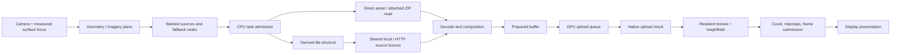

# Application-wide performance audit — native 0.1.5

**1 November 2026, Australia/Melbourne.** Audited publication `8c06ca6`,
application source `b0d76de4d551ee5ae68a18ce02e9bc210196ca84`.
This report covers source behavior, existing controlled measurements and current
research. It does not establish the cause of the user's phone stall or promise
an app-wide speedup. No application changes, new benchmark suites or APK rebuild
were needed for the audit. The requested surface-focus implementation is finished
and available in [0.1.5](../checkpoints/README.md).

## Executive assessment

The strongest next improvement is a **complete asynchronous tile state machine**:
all local and network I/O produces shared source futures; decoding runs only when
inputs are ready; prepared tiles stay pending until GPU admission succeeds; work
is prioritized by its contribution to visible detail. Current queues implement
several of these mechanisms individually, but their boundaries still have gaps.

The most consequential findings are:

1. **Local imagery reads still block CPU image workers.** Attached ZIP access and
   asset reads bypass the asynchronous transport path. Slow storage or a document
   provider can occupy both image workers while network diagnostics appear quiet.
2. **Retryable GPU upload failures can lose their queue entry.** A prepared tile
   is removed before upload; failure is returned as a Boolean and not requeued.
   This can leave coarse cover until another event restarts admission.
3. **Generic retry delays include 15 seconds.** Provider failures, decode errors
   and storage errors do not have a sufficiently differentiated recovery path.
4. **Tile selection still uses a universal -100..4000 m height prism.** Real
   measured bounds could safely eliminate some irrelevant requests. Unknown
   coverage must keep conservative bounds.
5. **There is still no correlated trace for a particular blurry patch.** Aggregate
   counters cannot identify which dependency, queue or upload outcome delayed it.

These are verified code paths or explicit architecture gaps. Their frequency and
contribution on the phone remain unmeasured. The CPU/HTTP fixtures from earlier
passes did not prove that the reported ten-second problem was solved.

## Baseline and method

| Item | Audited value |
| --- | --- |
| Native app | 0.1.5-surface-focus, code 6, `nz.ridgeline.nativeapp.performance` |
| APK | 32,056,100 bytes; SHA-256 `8530a2bb0f871226621be3db06c55b49cac966174081723ba10e7f4dbdf82122` |
| Native libraries | Optimized ARM64, ARMv7 and x86_64 |
| Native origin | Requested 0.1.1 publication `93be86c`, with subsequent improvements |
| Reference app | Capacitor 0.18 source `d880143418ac46ece98adff0b3b2fbaedf044d46` |
| Reference download branch | `android-preview-download` at `39431dad` |
| Production source inventory | 63 Kotlin/Rust/shader/manifest files, hashed in the evidence manifest |
| Runtime evidence available | Existing host fixtures; no attached physical Android device |

Reviewed areas: startup/device creation, lifecycle, camera/input and focus,
selection/HLOD, source ownership, transfer dispatch, local storage and packs,
encoded/decoded/prepared caches, composition, CPU queues, GPU upload/retention,
mipmaps, shader submission, presentation, memory, offline downloads, native UI,
location callbacks and build configuration. Route-planning algorithm optimization
remains outside scope. Inventory is a reproducibility record, not a claim of a
formal correctness proof for every line.

**Correction to the earlier comparison:** Android's `NativeBridge.tileBudget`
actually calls `Renderer::set_coordinated_retention`. There is already a combined
GPU payload-byte target plus count limits. The previous statement that Android
primarily lacked GPU byte budgeting was inaccurate. The remaining accounting gap
is active work, physical texture pages, CPU copies and other allocations beyond
that target. See F09 and the corrected [earlier audit](MAPLIBRE-GAPS-0.1.4.md).

Some migration notes are stale: `GOAL.md` still describes a skirt-free checkpoint,
while current code and later progress records implement selective skirts. This
audit uses the current implementation; it does not recommend changing skirts,
pixels, filtering, detail ceilings or resolution to hide a performance problem.

## How a tile reaches the screen

The direct local-read branch and the upload acknowledgement boundary deserve
immediate attention. A tile's bytes being downloaded, decoded, submitted and
actually shown are different milestones.

## Ranked findings

Priority means recommended order of investigation/implementation, not proof of
phone causality. **P0** is the next diagnostic/correctness work; **P1** is a strong
structural candidate; **P2** is workload-dependent optimization. Every finding has
a pinned source anchor in [findings.json](../validation/full-audit-2026-11-01/findings.json)
and a sortable [CSV](../validation/full-audit-2026-11-01/priorities.csv).

### F00 — Correlate a blurry patch with its actual blocking stage — P0

Current diagnostics show logical/underlying HTTP counts, request ages and CPU/GPU
queues. They do not correlate a selected image coordinate with dependency waits,
errors, prepared-cache outcomes, rejected uploads and its first draw. Add a
bounded opt-in event ring using tile ID, source generation and view epoch; include
local queue/read, HTTP queue/DNS/connect/headers/body/progress, decode, composition,
preparation, GPU admission result and draw submission. Keep the current underlying
canceled-call counts. Do not equate draw submission with display presentation.

This is a prerequisite for attributing the ten-second stall. It also makes every
following optimization falsifiable.

### F01 — Local imagery I/O bypasses asynchronous source admission — P0

`NativeImagery.saved/base` reads assets and attached ranges directly while
`TileLoader.loadImage` occupies an image worker. `OverviewAttachments` opens a
content-provider descriptor and performs positional reads. HTTP cancellation and
derived-cache deadlines do not make this path asynchronous or interruptible.

Move these reads into shared local-source futures before CPU decode admission.
Use bounded I/O workers, explicit ownership and provider cancellation where
supported. Preserve original ZIP bytes, offsets and preference for local data.
Do not simply add more image workers or treat a timed-out local original as
permission to change its imagery semantics. This is particularly important with
slow SD storage or provider-backed documents; the phone's URI/storage state is
unknown. Healthy internal-storage reads may already be fast.

### F02 — Prepared tiles need explicit GPU admission acknowledgement — P0

`TerrainView.drawFrame` removes a tile using `uploads.take`, calls a Boolean JNI
upload and does not requeue a failed item. Rust can reject capacity/admission;
JNI collapses failure to false. `onData` is posted only if at least one upload
succeeds. The worker considers preparation finished before this acknowledgement.
A ready-buffer cache may allow recovery on a later event, but that is not a
reliable retry contract. Occurrence during the phone stall is not established.

Return typed outcomes: accepted/already resident, retryable capacity, invalid
payload and device failure. Retain one bounded prepared payload until acceptance,
cancellation or permanent failure. Retry capacity failures on a capacity/frame
wake, preserving current relevance and avoiding busy-loop retries of bad payloads.

### F03 — Recover by failure class, rather than generic 1/4/15 s waits — P1

All ordinary task exceptions currently share these backoffs. An unrelated tile
upload clears the visible status text. A critical image can remain coarse while
its error becomes unobvious. Preserve the failure reason and retry deadline in
F00. Respect provider retry metadata; distinguish permanent HTTP responses,
transient connection failures, corrupt disposable cache entries and invalid source
payloads. Corrupt cache recovery should not unnecessarily wait like an overloaded
provider. Keep retries bounded; a tighter timer alone is not a diagnosis.

### F04 — Feed conservative measured terrain bounds into selection — P1

The selector tests every candidate against -100..4000 m even when real terrain
exists in RAM. MapLibre's packaged covering code queries available terrain
min/max. Introduce a versioned hierarchy of conservative known bounds, including
all required coverage/halo dependencies; retain broad bounds whenever coverage is
unknown or incomplete. This can reduce false-positive off-screen work and free
the selection budget for visible detail. It does not justify assuming flat ground
or aggressively culling an unseen mountain.

### F05 — Schedule visible refinement as a dependency graph — P1

Current plans, parent ranks, transfer permits, CPU queues and upload budgets are
locally sensible but not one end-to-end readiness model. A high-ranked expensive
job may still contribute no visible improvement until several other stages finish.

Track each requested tile's current drawn quality, target quality, shared inputs,
remaining stages and relevance epoch. Promote a shared input according to all
visible dependants. Prioritize expected visible improvement and critical-path
cost while retaining starvation bounds and fallback coverage. Release obsolete
ownership across the entire graph. Cesium Native's selection/load/render-state
separation and bounded completion work are useful references [R1]; the raster/DEM
adaptation needs its own quality invariants.

### F06 — A derived-cache deadline should start fallback work, not discard all late value — P1

`DerivedReadGate` resolves a lookup as null after 12 ms. If a valid file finishes
at 18 ms while rebuilding takes hundreds of milliseconds, that result cannot
win. This avoids blocking workers but can waste useful prepared data on a slower
phone. Allow the first still-valid result to win until source generation or
attachments invalidate it. Validate dependencies at adoption and cancel only
this operation's unnecessary leases. Preserve bounded readers/memory and avoid
an obsolete cached result replacing newer source data. Measure cache latency
and late-hit rates before choosing device-adaptive deadlines.

### F07 — Saved readers can wait on the background writer's monitor — P1

`OfflineStore.hasResources` is synchronized even after its volatile state is
known. `keep/begin/status/delete` synchronize on the same store, including
transactions. A foreground read can therefore wait before reaching SQLite's WAL
reader path. WAL alone cannot remove the application's monitor contention [R2].
Use a known-state fast path, limited initialization locking, bounded
commit-invalidated negative lookup memo and batched writes. This matters with
saved regions/download activity; it is not an explanation when the store is empty
and no writer is active. Preserve durability and invalidation epochs.

### F08 — Establish local-coverage parity before attributing all differences to rendering — P0 check

Native Base contains 67 coarse images and no six large packs. Capacitor Full
contains 5,344 overview images. Native supports attaching the original ZIPs, but
the new separately signed package could not automatically inherit old private
cache/attachment permissions. The phone's current attachment count is unknown.
Compare Base with Base or attach the same packs to both. Improve first-run
coverage/reattachment guidance and distinguish network refinement from local
coverage. This can eliminate requests where exact local data already exists; it
is not a substitute for fixing online cold-area performance. Finer imagery and
terrain can still need network access with all packs present.

### F09 — Extend existing memory coordination to active and physical allocations — P1

GPU live payloads already have a coordinated byte target. CPU retention is split
across encoded, decoded and prepared budgets. Queue-held buffers, operation pins,
CPU resident heightfields, array-page high-water allocation, depth/surface buffers
and driver memory are additional concerns. Count unique allocations: queue and
RAM cache often reference the same buffer and must not be counted twice.

Expose active bytes and allocated-versus-live page bytes; constrain upstream
preparation when GPU consumption cannot keep up. Preserve useful coverage while
shedding speculative work first. This addresses reclaim/GC/low-memory pressure
and energy, not just cache hit rate. Measure PSS and allocator/driver information
rather than promising a universal memory limit from payload arithmetic alone.

### F10 — Batch GPU mip work; evaluate staging reuse carefully — P1

GPU mip paths submit an encoder per image, in addition to the frame submission.
Collect a bounded group into fewer submissions while preserving mip dependencies
and shared scratch reuse. wgpu recommends limiting submissions [R3]. Evaluate
batching without waiting to fill a batch: a ready critical tile must not acquire
another avoidable delay. Evaluate
staging reuse only when traces show allocation/copy cost. A staging belt writes
buffers; texture upload needs a copy-to-texture path [R4]. In particular, a 129-wide
R32 height row is 516 bytes and needs padding for a 256-byte-aligned buffer copy;
that can offset a proposed gain. Keep every original mip/filtering level.

### F11 — Coordinate persistence across normal and escape HTTP paths — P1

The normal HTTP cache can be large, while escape bodies use at most 16 MiB from
the same total disposable allowance. Frequent escape routing can therefore have
a smaller effective revisit cache than the user's total setting suggests.
Measure route reason, hit/miss, write/drop and eviction counts first, including
backend-selected escapes that bypass the transport's escape counter. Then
coordinate retention fairly while preserving total disk limits, freshness,
no-store and offline behavior. Replacing OkHttp caching wholesale is a larger
correctness project, not an automatic optimization.

### F12 — Download resources without rendering and discarding every image — P1

Offline download invokes `imagery.load`, decoding/composing pixels that are
then discarded, and uses a fixed DEM-neighbour policy with a shared dedupe set.
Plan exact source dependencies and commit bounded resumable batches instead of
rendering solely to save input bytes. Keep DEM validity/parent-hole discovery
where necessary. Do not blindly remove halos, fine-source veto inputs or terrain
levels promised by the selected offline detail. Shared neighbours mean that a
naive nine-versus-four calculation is not a real request-count speedup. Batching
also shortens foreground interference from F07.

### F13 — Bound startup/recovery validation waits; persist supported pipeline caches — P1/P2

Startup selects a backend, compiles pipelines and performs correctness probes.
`diagnostics.rs` includes indefinite GPU polling; these probes are reached during
renderer initialization on applicable paths. Device-loss callback setup follows
successful renderer creation. Investigate bounded failure handling and record
which stage hangs, preserving correctness checks. A library timeout is not a
universal way to interrupt a driver stuck inside an API call.

Separately, pipeline descriptors use `cache: None`. wgpu 30.0.1 supports persistent
pipeline caches on Vulkan [R5], subject to feature support and device/driver/cache
validity. Atomic, versioned cache persistence can improve repeat startup/recovery;
it does not fix a slow new image in an already healthy renderer. Do not remove
mipmap correctness probes indiscriminately or assume a Vulkan cache helps GLES.

### F14–F15 — Reduce static metadata and steady-frame CPU work — P2

The overview index is 1,314,013 bytes and gap atlas 720,344 bytes. The first
planner/image task touching a lazy catalog initializes it; this can delay initial
demand publication and serialize other readers. Evaluate generated compact,
validated indexes or asynchronous initialization; keep original imagery and
composition masks intact. This targets cold metadata latency and allocation.

Rendering still creates rectangle vectors, sets and overflow maps each frame.
Cache/reuse topology only when cover, seam and adaptive-level revisions permit it.
Existing geographic merge, seam proofs, reusable grid, source/cover caches and
instance-upload suppression are already implemented; do not replace them with
another speculative rewrite. Pixel-equivalent output and complete-frame CPU
measurements matter more than fewer allocations alone.

### F16 — Separate surface-stop acknowledgement from safe deferred cleanup — P1

`surfaceDestroyed` can wait five seconds on the UI thread for GPU-owner teardown.
This threatens lifecycle responsiveness if a driver stalls. The Android contract
requires rendering to stop touching the Surface before returning [R6]; simply
removing the wait would be incorrect. Design a prompt ownership acknowledgement,
then defer resource cleanup that is safe to defer. This is a lifecycle finding,
not an established cause of blurry imagery during an unchanged view.

### F17/F21 — Use actual pacing and scheduling capabilities — P2

Upload allowance defaults to a 16.67 ms frame period with 2/4 ms upload caps, while
presentation uses Choreographer and a requested frame latency of two. These are
useful safeguards, not measurements of actual display/compositor timing. Match
refresh/deadline data and distinguish CPU enqueue, GPU completion and presentation.
Android's pacing guidance explains why vsync callbacks alone can still permit
buffer stuffing [R7]. Swappy is not a drop-in call around wgpu: wgpu owns present;
double-presenting or adding a second pacing loop would be wrong.

Several background pools use default thread priority. Use traces to establish
run-queue competition, then distinguish non-visible CPU/storage work from the
render owner. Capability-gated thermal/performance hints can help sustained
operation [R8]; API 31 performance hints cannot be assumed on an API 30 phone.
Reduce unnecessary background work under pressure while preserving chosen detail.

### F18/F19 — Release/runtime and pixel-path optimization — P2

The checkpoint is debuggable, with optimized Rust libraries. A comparable
nondebuggable build with ART Baseline/Startup Profiles can improve managed-code
warmup [R9]; it does not optimize Rust. Rust PGO is a separate, representative-
workload experiment [R10], with no borrowed percentage speedup claim.

Image decode/getPixels/packing and DEM conversion use several CPU representations.
Explore direct/native pixel access or a proven opaque fast path only with correct
channel order, alpha premultiplication, color behavior, ownership and row stride.
Do not assume an Android bitmap buffer is interchangeable with existing RGBA.
These save preparation cost if it is measured as significant; they do not remove
a ten-second provider or retry delay.

### F20 — Preserve freshness/version across all retention tiers — P1 prerequisite

Decoded DEMs carry dependency stamps, but `ready` payloads are keyed by source ID
without equivalent freshness metadata. GPU upload also touches an existing ID
instead of replacing it with a new version. Explicit mode/attachment invalidation
and process recreation handle some cases, not every normal source-version change.
Carry immutable version/freshness through ready and resident states before making
retention more aggressive. Otherwise a higher cache hit rate can mean retaining
superseded content. This is a correctness prerequisite for performance work, not
evidence for the reported cold-area delay.

### F22 — Distinguish whole-operation latency from read inactivity — P1

The client sets 12 s connection and 15 s read timeouts, without an explicit total
call timeout. Read timeout is not a whole-download deadline: a slowly progressing
body may last longer. Record DNS/connect/headers/body progress and current
relevance before choosing an absolute/adaptive deadline. Do not arbitrarily kill
a shared live transfer or duplicate every slow request against the same origin.
Connection reuse is already present. A different protocol is an experiment below.

## Current research: useful techniques and limits

| Technique | Fit for this app | Decision |
| --- | --- | --- |
| Visible-benefit / cost-aware dependency scheduling | Targets whole visual completion rather than isolated queue throughput; integrate source sharing and accepted-upload state. | Highest-value architecture experiment, F00–F05. |
| Measured hierarchical bounds and conservative visibility feedback | Uses loaded terrain to avoid unnecessary requests; unknown/new coverage remains conservative. | Strong next selection improvement. GPU depth/ID feedback is a later experiment: readback delay, thin terrain and motion invalidate naive occlusion. |
| Persistent pipeline caches / newer pipeline binaries | Supported wgpu Vulkan cache can reduce repeat compilation. Newer Vulkan binary extensions are not automatically exposed by wgpu. | Start with the supported cache API; gate by device/driver/shader identity. |
| Batched mip generation and reusable staging rings | Potentially lowers submit and allocation overhead without altering pixels. | Benchmark on the actual GPU; fence-safe reuse and row alignment are required. |
| Cronet / HTTP/3 over QUIC | Cronet supports HTTP/3 and request priorities [R11]. May help transport stalls when the origin and network negotiate it. | Conditional prototype only; verify actual protocol, cancellation, cache/offline parity and APK cost. It cannot fix CPU, SQL or GPU waits. |
| Software virtual texturing / GPU feedback / bindless | Could reduce geometry/photo fragmentation or drive demand from actual visibility. Existing arrays already capture part of the benefit. | High complexity; require a measured fragmentation/CPU/binding bottleneck. Handle mip borders, fallback ownership and delayed feedback exactly. |
| Sparse textures / descriptor indexing / mesh-driven rendering | Vulkan sparse residency and descriptor indexing require optional features [R12–R13]; newer devices differ greatly from older Mali-class phones. | Not a universal replacement for the existing renderer; preserve fallback and avoid a speculative native-Vulkan fork. |
| ADPF / thermal-aware background work | Useful for sustained CPU scheduling and preventing unnecessary background pressure. | Runtime/API-gated; no automatic resolution/detail reduction. |
| ASTC/Basis-style GPU compression | Can reduce GPU bandwidth, but ASTC is lossy [R14]; runtime encoding/transcoding adds work and format support varies. | Not a default recommendation under the user's full-quality requirement. Keep exact sources and require explicit visual policy/evidence for any experiment. |
| PGO, Baseline Profiles and compact catalog indexes | Can improve CPU/startup paths after attribution. | Lower priority than lost admission, blocking I/O and retry stalls. |

On mobile tile-based GPUs, memory traffic and pass structure matter [R15]. The
current render pass already discards depth storage and uses mipmaps/array batching.
Do not add a depth prepass, force texture arrays on GLES, enable new multi-pass
lighting or remove validation merely because a newer technique sounds faster.
The prior software-GLES measurements already showed that fewer draws could still
be slower overall. Vulkan-versus-GLES should be a controlled hardware comparison,
not an assumption based on API age.

## Smallest useful validation sequence

1. **Capture one real stall:** record pack/region state, exact view/detail/backend,
   current target tile and F00 stages. Identify whether the image was queued,
   downloading, processing, rejected or already drawn at a coarser target.
2. **Admission correctness:** inject one retryable GPU-capacity failure; the still-
   wanted tile must eventually be accepted without another download or camera
   movement. Invalid payload/device failure must not create an endless retry loop.
3. **Raw local-source independence:** delay an attached range read; an unrelated
   ready visible image must still decode. Cancel the old consumer while preserving
   another consumer's shared data and original source selection.
4. **Selection and late-cache cases:** compare exact known-bound conservative cover
   and a prepared result that arrives just after the shortcut deadline. Verify
   no holes/version regression and record work avoided, not just time to a miss.
5. **Only then benchmark GPU batching/startup changes:** one stable loaded replay
   and one cold refinement replay, identical detail and data, before/after on the
   same physical device. Use a few alternating runs and report distributions.

Track focus-target completion, time to substantial target-detail coverage,
current-view queue age, bytes downloaded and downloaded-but-never-used work.
First coarse coverage and final requested detail are separate metrics. Visible-
area coverage estimates must be labeled approximate unless actual screen-space
coverage is measured. Do not substitute total tile completions or UI FPS.

**Measurement caveats:** Perfetto is available on modern Android, but FrameTimeline
requires Android 12+, and the currently retrieved documentation explicitly warns
that SurfaceViews are not supported [R16]. This app renders into a SurfaceView.
Verify target-device support and use appropriate SurfaceFlinger/presentation-fence
signals, native timestamps and screen evidence; HWUI `gfxinfo` is not automatically
the map renderer's presented FPS. Older API devices need the compatible tracing
path. GPU timestamp queries also need actual device feature support and explicit
wgpu enablement. The current device request does not enable timestamp features.

No new tests were run for this report. Existing four focused surface-focus checks
and APK verification are recorded with 0.1.5; earlier host timing fixtures remain
conditional examples, not current native-versus-Capacitor phone benchmarks.

## Recommended order and deliverables

- **First:** F00 trace + F02 upload acknowledgement; F08 runtime coverage check.
  Deliver an explanation of one stalled visible tile and a bounded retry contract.
- **Second:** F01 all source I/O through asynchronous providers, F03 classified
  recovery, F07 saved-reader isolation, F06 first-valid prepared/source race.
  Deliver ready CPU work that cannot wait on unrelated storage or be lost at GPU
  admission, with source/quality/durability unchanged.
- **Third:** F04 measured bounds and F05 visible-refinement graph; F09 active-memory
  pressure, F11 cache policy and F12 resource-only offline planning. Deliver fewer
  irrelevant requests and less redundant work at the same requested quality.
- **Fourth:** F10/F13/F14/F15/F17–F19/F21 hardware-attributed GPU, startup, CPU and
  thermal work. Keep an experiment only when the target metric improves without
  quality, lifecycle, cache correctness or tail-latency regression.

There is no defensible app-wide percentage estimate yet. The strongest likely
breakthrough is eliminating wasted/blocked stages across the full visible-tile
lifetime, with GPU acceptance and actual visibility included in scheduling.

## Primary research references

Retrieved 1 November 2026; live documentation can change. Paraphrases describe
applicable mechanisms, not transferable benchmark percentages.

- **R1:** [Cesium Native selection/load/render algorithm](https://cesium.com/learn/cesium-native/ref-doc/selection-algorithm-details.html).
- **R2:** [SQLite WAL concurrency](https://www.sqlite.org/wal.html).
- **R3:** [wgpu submission best practices](https://wgpu.rs/doc/wgpu/documentation/best_practices/dos_and_donts/index.html).
- **R4:** [wgpu 30 Queue](https://docs.rs/wgpu/30.0.1/wgpu/struct.Queue.html) and [StagingBelt](https://docs.rs/wgpu/30.0.1/wgpu/util/struct.StagingBelt.html).
- **R5:** [wgpu 30.0.1 PipelineCache](https://docs.rs/wgpu/30.0.1/wgpu/struct.PipelineCache.html), [Khronos pipeline management](https://docs.vulkan.org/samples/latest/samples/performance/pipeline_cache/README.html), [newer pipeline binary sample](https://docs.vulkan.org/samples/latest/samples/extensions/pipeline_binary/README.html).
- **R6:** [Android SurfaceHolder.Callback ownership contract](https://developer.android.com/reference/android/view/SurfaceHolder.Callback).
- **R7:** [Android frame pacing](https://developer.android.com/games/sdk/frame-pacing).
- **R8:** [ADPF](https://developer.android.com/games/optimize/adpf), [PerformanceHintManager API 31](https://developer.android.com/reference/android/os/PerformanceHintManager), [thermal support](https://developer.android.com/games/optimize/adpf/thermal).
- **R9:** [Android Baseline Profiles](https://developer.android.com/topic/performance/baselineprofiles/overview).
- **R10:** [Rust PGO](https://doc.rust-lang.org/rustc/profile-guided-optimization.html).
- **R11:** [Cronet protocol/priority capabilities](https://developer.android.com/develop/connectivity/cronet).
- **R12:** [Khronos sparse resources](https://docs.vulkan.org/guide/latest/sparse_resources.html).
- **R13:** [Khronos descriptor indexing](https://docs.vulkan.org/samples/latest/samples/extensions/descriptor_indexing/README.html).
- **R14:** [Arm ASTC format overview](https://github.com/ARM-software/astc-encoder/blob/main/Docs/FormatOverview.md).
- **R15:** [Khronos mobile tile-based rendering guidance](https://docs.vulkan.org/guide/latest/tile_based_rendering_best_practices.html).
- **R16:** [Perfetto FrameTimeline limitations](https://perfetto.dev/docs/data-sources/frametimeline) and [Android system tracing](https://developer.android.com/topic/performance/tracing).

## Pinned code evidence

| ID | Priority | Finding | Pinned source |
| --- | --- | --- | --- |
| F00 | P0 | Correlate every visible tile through first draw | [TileLoader.kt:362](https://github.com/connorgleeson736-sys/Ridgeline/blob/8c06ca6/native-wgpu/android/app/src/main/java/nz/ridgeline/nativeapp/TileLoader.kt#L362) |
| F01 | P0 | Move raw imagery ZIP/asset I/O off decode workers | [NativeImagery.kt:50](https://github.com/connorgleeson736-sys/Ridgeline/blob/8c06ca6/native-wgpu/android/app/src/main/java/nz/ridgeline/nativeapp/NativeImagery.kt#L50) |
| F02 | P0 | Keep retryable uploads pending until accepted | [TerrainView.kt:156](https://github.com/connorgleeson736-sys/Ridgeline/blob/8c06ca6/native-wgpu/android/app/src/main/java/nz/ridgeline/nativeapp/TerrainView.kt#L156) |
| F03 | P1 | Replace generic retry/backoff with classified errors | [TileLoader.kt:201](https://github.com/connorgleeson736-sys/Ridgeline/blob/8c06ca6/native-wgpu/android/app/src/main/java/nz/ridgeline/nativeapp/TileLoader.kt#L201) |
| F04 | P1 | Use versioned measured terrain extrema for covering | [selection.rs:153](https://github.com/connorgleeson736-sys/Ridgeline/blob/8c06ca6/native-wgpu/renderer/src/selection.rs#L153) |
| F05 | P1 | Prioritize work by visible benefit and dependency cost | [SourceDemand.kt:27](https://github.com/connorgleeson736-sys/Ridgeline/blob/8c06ca6/native-wgpu/android/app/src/main/java/nz/ridgeline/nativeapp/SourceDemand.kt#L27) |
| F06 | P1 | Allow a late valid prepared result to win | [DerivedReadGate.kt:38](https://github.com/connorgleeson736-sys/Ridgeline/blob/8c06ca6/native-wgpu/android/app/src/main/java/nz/ridgeline/nativeapp/DerivedReadGate.kt#L38) |
| F07 | P1 | Remove saved-reader monitor contention and memoize misses | [OfflineStore.kt:15](https://github.com/connorgleeson736-sys/Ridgeline/blob/8c06ca6/native-wgpu/android/app/src/main/java/nz/ridgeline/nativeapp/OfflineStore.kt#L15) |
| F08 | P0 | Establish actual Base/Full and attachment parity | [OfflineUi.kt:98](https://github.com/connorgleeson736-sys/Ridgeline/blob/8c06ca6/native-wgpu/android/app/src/main/java/nz/ridgeline/nativeapp/OfflineUi.kt#L98) |
| F09 | P1 | Budget active work and actual page allocations | [residency.rs:7](https://github.com/connorgleeson736-sys/Ridgeline/blob/8c06ca6/native-wgpu/renderer/src/residency.rs#L7) |
| F10 | P1 | Batch GPU mip/upload submissions and evaluate staging reuse | [mipmaps.rs:412](https://github.com/connorgleeson736-sys/Ridgeline/blob/8c06ca6/native-wgpu/renderer/src/mipmaps.rs#L412) |
| F11 | P1 | Measure and coordinate escape-cache persistence | [TileLoader.kt:46](https://github.com/connorgleeson736-sys/Ridgeline/blob/8c06ca6/native-wgpu/android/app/src/main/java/nz/ridgeline/nativeapp/TileLoader.kt#L46) |
| F12 | P1 | Use raw dependency planning and batched durable commits | [TileLoader.kt:545](https://github.com/connorgleeson736-sys/Ridgeline/blob/8c06ca6/native-wgpu/android/app/src/main/java/nz/ridgeline/nativeapp/TileLoader.kt#L545) |
| F13 | P1 | Bound startup validation waits and evaluate pipeline caching | [diagnostics.rs:85](https://github.com/connorgleeson736-sys/Ridgeline/blob/8c06ca6/native-wgpu/renderer/src/diagnostics.rs#L85) |
| F14 | P2 | Pre-index static catalogs and avoid cold JSON parse barriers | [NativeImagery.kt:28](https://github.com/connorgleeson736-sys/Ridgeline/blob/8c06ca6/native-wgpu/android/app/src/main/java/nz/ridgeline/nativeapp/NativeImagery.kt#L28) |
| F15 | P2 | Cache or reuse frame index/rectangle scratch | [lib.rs:1496](https://github.com/connorgleeson736-sys/Ridgeline/blob/8c06ca6/native-wgpu/renderer/src/lib.rs#L1496) |
| F16 | P1 | Bound surface-stop acknowledgement separately from cleanup | [TerrainView.kt:290](https://github.com/connorgleeson736-sys/Ridgeline/blob/8c06ca6/native-wgpu/android/app/src/main/java/nz/ridgeline/nativeapp/TerrainView.kt#L290) |
| F17 | P2 | Measure real display deadlines and compositor latency | [UploadAdmission.kt:8](https://github.com/connorgleeson736-sys/Ridgeline/blob/8c06ca6/native-wgpu/android/app/src/main/java/nz/ridgeline/nativeapp/UploadAdmission.kt#L8) |
| F18 | P2 | Evaluate optimized nondebuggable ART profile and Rust PGO | [build.gradle.kts:12](https://github.com/connorgleeson736-sys/Ridgeline/blob/8c06ca6/native-wgpu/android/app/build.gradle.kts#L12) |
| F19 | P2 | Reduce proven-safe pixel copies and conversions | [PixelPacking.kt:8](https://github.com/connorgleeson736-sys/Ridgeline/blob/8c06ca6/native-wgpu/android/app/src/main/java/nz/ridgeline/nativeapp/PixelPacking.kt#L8) |
| F20 | P1 | Carry freshness/version through ready buffers and resident GPU tiles | [TileLoader.kt:106](https://github.com/connorgleeson736-sys/Ridgeline/blob/8c06ca6/native-wgpu/android/app/src/main/java/nz/ridgeline/nativeapp/TileLoader.kt#L106) |
| F21 | P2 | Separate background OS priority and thermal policy | [TileLoader.kt:74](https://github.com/connorgleeson736-sys/Ridgeline/blob/8c06ca6/native-wgpu/android/app/src/main/java/nz/ridgeline/nativeapp/TileLoader.kt#L74) |
| F22 | P1 | Record byte progress and set appropriate whole-operation deadlines | [TileLoader.kt:55](https://github.com/connorgleeson736-sys/Ridgeline/blob/8c06ca6/native-wgpu/android/app/src/main/java/nz/ridgeline/nativeapp/TileLoader.kt#L55) |
