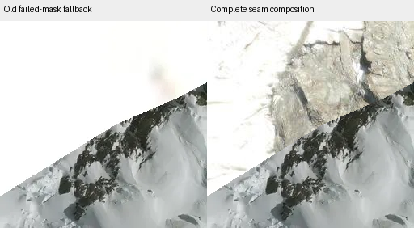

# Blurry LINZ/Esri borders near Mount Cook

Investigated native0.1.10 source655de14 and its signed published APK after the user
reported persistent blurry tiles near the imagery boundary around Mount Cook.
No phone trace was supplied; the following are reproduced source/pipeline failure
paths and live source checks, not proof that an outage occurred on that phone.

## Findings

**A failed seam donor could be accepted as a completed image.** Boundary tiles
need the original LINZ aerial tile, Esri imagery and (on the seam) individual LINZ
survey PNGs. Survey alpha decides where to retain LINZ and where to show Esri.
NativeImagery caught a survey transport IOException and returned the original
LINZ pixels. TileLoader then treated that as successful fine imagery, acknowledged
it to residency and could write a prepared composition using only the successful
source dependencies. Nothing in that cache entry required the failed survey to
recover. A bad result could remain resident or reusable until its other source
lifetimes expired, despite the missing source becoming available. HTTP/decode
errors followed a different failure path rather than this fallback.

**Repeated failures could leave a stationary view without another retry.** The
worker stored a15-second retry deadline after the first two delays (1s,4s), but
scheduled automatic wakeups only for attempts1–3. A fourth failure stored another
future deadline and scheduled no wakeup. The immediate planner call in finally
ran before that deadline and skipped the source. Without another camera/data
notification it could leave the retained parent blurry indefinitely. Any tile
can be affected; border tiles are exposed to more dependent requests.

**Border dependencies amplify latency.** The shipped atlas has630 entries.
Their fine-survey counts are0:74,1:368,2:135,3:40,4:7,5:6. A single seam tile can
therefore require LINZ+Esri+up to5 survey responses before its exact source mask
is known. Existing network admission still caps the total. This release does not
change the authoritative seam, lower source resolution, discard survey masks,
or pretend a partially known seam is complete.

## Exact Mount Cook sample

Requested tile17/127471/83202, centre170.1109314,-43.5853648, whose actual atlas
entry is7966/5200. Production geometry selection identifies a boundary. The
existing website vectorAlpha and native mask fixture agree on SHA-256
`16e4cefa03b41adbd63969b2629f15b705b9c7e7fff91d0ab86ae7c34744a965`.

The live LINZ aerial, Canterbury2015–2016 survey and Esri endpoints all returned
HTTP200 and256×256 images. The survey had36,308 transparent pixels and29,228
covered pixels. Complete composition selects Esri for36,308 pixels;29,213 differ
from the old LINZ-only failure fallback. The replacements contain detailed terrain
where the failure fallback is mostly white/low detail. This establishes that
replacement imagery exists for this sampled Cook seam, rather than proving the
user's exact view or network history.

Image comparison uses decoded live source data and the reference hard mask; it is
not an Android screen capture. Seven total source checks across Cook and an Otago
sample all returned valid200 images. Observed cloud request intervals were about
0.67–1.62s, including this environment's proxy/cache/network conditions. They do
not measure the phone's Wi-Fi or establish bandwidth saturation. Probe records
contain no API keys. The app's existing Esri ceiling remains z18; legitimate
source-resolution softness at closer views is separate from recovery failures.

## Fix

* Survey-mask transport failures now propagate to normal tile failure/retry.
  Existing parent coverage remains visible; incomplete LINZ-only replacements
  cannot receive a full success acknowledgement or enter the composition cache.
  The successful composition math, crop/filtering and source pixels are unchanged.
* The prepared-composition namespace is bumped. Old fallback results are bypassed
  without erasing the valid original HTTP/source cache, saved regions or imports.
  Old disposable compositions remain bounded and age out under the existing LRU.
* Still-wanted transient IO failures, HTTP408/429 and5xx continue to schedule a
  retry after the established capped15s delay. The first1s/4s retries are retained.
  Permanent HTTP/decode failures retain the previous finite automatic retries.
  Wakeups check the latest failure identity, current wanted set and active app,
  so retired requests cannot revive old demand. Concurrency stays unchanged.

## Focused verification / limits

A focused real-loopback HTTP/transport check injects four503 survey responses,
then returns the original bytes on request five. Production retry policy permits
recovery beyond the old cutoff. A404 control retains the previous finite retries.
Backoff delays are advanced virtually, not slept or reported as measured latency.
The source-geometry checks include the exact Cook tile and reference mask digest,
plus existing ordered source/mask goldens. No broad suite/lint or Rust rebuild is
needed for these Kotlin-only corrections. Final signed APK and original-asset/
library comparisons are recorded alongside the focused logs.

No physical device was connected. Phone installation, touch behaviour, actual
outage reproduction and the user's exact blurred tiles remain unverified. A new
APK cannot increase the underlying source imagery's true detail. The correction
addresses two concrete ways required fine imagery can fail to replace a parent.
